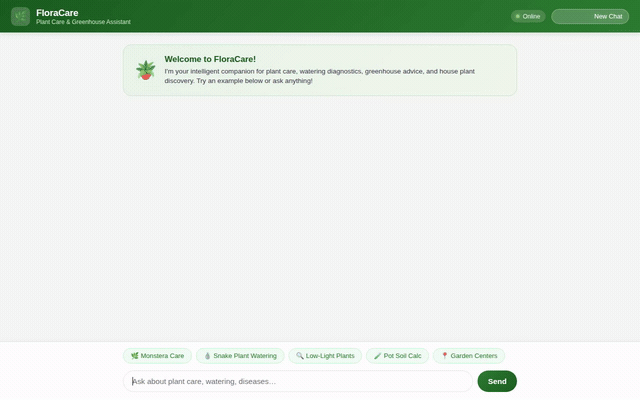

# 🌿 FloraCare — Plant Care & Greenhouse Assistant

An intelligent, multimodal conversational agent for house plant care, watering diagnostics, greenhouse inventory management, and botanical discovery. Built with the **Google Agent Development Kit (ADK)** and powered by **Gemini**.

<div align="center">



[](https://google.github.io/adk-docs/)
[](#)
[](#)
[](#)

</div>

---

## 🌟 What FloraCare Does

FloraCare pairs botanical domain expertise with live cloud tools and long-term memory:

- **Personalized Plant Care & Scheduling**: Computes precise watering intervals based on species, pot type, drainage, season, and ambient temperature/humidity.
- **Persistent Cross-Session Memory**: Remembers your home garden collection, lighting setup, watering history, and gardening experience level across conversations.
- **Live Greenhouse Inventory**: Connects to Cloud Firestore to look up, add, and update live stock levels for indoor plants, tropical foliage, succulents, and trees.
- **Multimodal Visualizations**: Generates photorealistic plant portraits and growth time-lapse videos on demand, saved to Cloud Storage and rendered directly in chat.
- **Rich A2UI Cards**: Displays care guides, inventory catalogs, and plant photos using structured Agent-to-User Interface (A2UI) cards rather than raw markdown.
- **Local Garden Center Locator**: Geocodes user locations to find nearby nurseries, garden centers, and plant clinics.

---

## 🛠️ Google Cloud Services & Tools Wired Up

All capabilities listed below are fully implemented and wired into the agent runtime:

### 1. Long-Term Memory (Vertex AI Memory Bank)
- **`PreloadMemoryTool`**: Automatically injects relevant long-term memories into the model's context at the start of each conversation.
- **`generate_memories_callback`**: Runs after agent responses to extract key facts (e.g., plants owned, room conditions, user preferences) and writes them to the managed Vertex AI Memory Bank.

### 2. Live Database (Cloud Firestore)
- **`list_inventory`**: Retrieves plant records filtered by category (*Tropical Foliage*, *Succulent*, *Indoor Tree*, *Flowering Houseplant*, *Trailing Vine*).
- **`get_plant`**: Fetches detailed care instructions, difficulty rating, price, and current stock for an individual plant.
- **`add_plant`**: Registers new botanical species into the catalog with full metadata.
- **`update_plant_stock`**: Atomically updates inventory counts when items are restocked or purchased.

### 3. Media Storage (Google Cloud Storage)
- **Public Cloud Storage Bucket**: Automatically hosts generated botanical media, providing durable public HTTPS endpoints rendered within conversation cards.

### 4. Generative Media Models
- **AI Image Generation (`generate_plant_image`)**: Generates photorealistic plant portraits and room styling previews using `gemini-3.1-flash-lite-image`. Uploads images to Cloud Storage and saves session artifacts.
- **AI Video Generation (`generate_plant_video`)**: Generates botanical time-lapse clips using Google Omni (`gemini-omni-flash-preview` in the `global` region). Uploads video files to Cloud Storage and records them in session artifacts.

### 5. Agent-to-User Interface (A2UI)
- **`a2ui_callback`**: Transforms model responses into structured visual cards (headings, badges, metadata rows, and embedded cloud images) displayed cleanly in the web UI.

### 6. Botanical & Location Functions
- **`calculate_watering_schedule`**: Calculates seasonal schedules factoring in pot material, soil drainage, and temperature.
- **`search_species_taxonomy`**: Botanical taxonomy, native habitat, humidity, and care guidelines.
- **`geocode_address` & `search_nearby_places`**: Converts locations to coordinates and queries nearby garden centers.
- **`get_weather`**: Fetches ambient temperature and humidity to adjust watering recommendations.
- **`get_current_time`**: Resolves current seasonal context.

### 7. Isolated Code Sandbox
- **`AgentEngineSandboxCodeExecutor`**: Executes ad-hoc Python calculations (fertilizer dilution, potting soil volume) within an isolated Vertex AI sandbox.

---

## 📁 Repository Structure

```
├── app/                        # ADK agent package
│   ├── agent.py                # Agent definition, tools, and callbacks
│   ├── a2ui_utils.py           # A2UI card renderer callback
│   └── fast_api_app.py         # Backend FastAPI application
├── frontend/                   # Web frontend
│   ├── main.py                 # FastAPI reverse proxy to Agent Engine (A2A)
│   └── static/
│       ├── index.html          # Chat interface with A2UI renderer
│       └── style.css           # FloraCare botanical styling
├── seed_firestore.py           # Firestore inventory bootstrap script
├── agents-cli-manifest.yaml    # Deployment configuration
├── pyproject.toml              # Dependencies and packaging
├── project_brief.md            # Agent design specification
└── demo.gif                    # Recorded interaction walkthrough
```

---

## 🚀 Getting Started

### Prerequisites

- Python 3.11+
- [uv](https://docs.astral.sh/uv/) package manager
- [Google Cloud SDK (`gcloud`)](https://cloud.google.com/sdk/docs/install)
- A Google Cloud project with **Vertex AI API**, **Cloud Firestore**, and **Cloud Storage** enabled

### 1. Authenticate with Google Cloud

```bash
gcloud auth login
gcloud auth application-default login
gcloud config set project YOUR_PROJECT_ID
```

### 2. Environment Setup

Create a `.env` file in the project directory:

```bash
GOOGLE_CLOUD_PROJECT=YOUR_PROJECT_ID
GOOGLE_CLOUD_LOCATION=us-east1
GOOGLE_GENAI_USE_VERTEXAI=true
FIRESTORE_PROJECT_ID=YOUR_PROJECT_ID
STORAGE_BUCKET_NAME=YOUR_PUBLIC_BUCKET_NAME
MEMORY_BANK_ID=YOUR_MEMORY_BANK_ID
```

Install dependencies:

```bash
uv sync
```

### 3. Seed the Greenhouse Inventory

Populate Firestore with the initial catalog:

```bash
uv run python seed_firestore.py
```

### 4. Run the Agent Locally

You can test the agent locally using the ADK Playground:

```bash
uv run adk web app
```

Or run the full web frontend proxy:

```bash
export AGENT_ENGINE_RESOURCE_NAME="projects/YOUR_PROJECT_ID/locations/us-east1/reasoningEngines/YOUR_ENGINE_ID"
export AGENT_DIRECTORY="app"
export PORT=8080

cd frontend
python main.py
```

---

## 📜 License

Apache 2.0
